  

  

 

 

<h3>Projetos em destaque</h3>

 

  <a href="https://github.com/IFC-Hackathon-2026/hackas-front.git"><b>FarolFlow</b></a>
  — Plataforma de gerenciamento de eventos, equipes e tarefas.

  <a href="https://github.com/LauraEloysa?tab=repositories&q=Robotica"><b>RobóticaIFC</b></a>
  — Plataforma educacional para o ensino de robótica.

  <a href="https://github.com/LauraEloysa?tab=repositories&q=Cinemap"><b>Cinemap</b></a>
  — Aplicação para explorar e organizar informações sobre filmes.

 
 

  <h2>Estatísticas do GitHub</h2>

  <table>
    <tr>
      <td align="center">
        
      </td>
      <td align="center">
        
      </td>
    </tr>
  </table>

 
 

<h3>Entre em contato</h3>

  

  

  

 
 

  <picture>
    <source
      media="(prefers-color-scheme: dark)"
      srcset="https://raw.githubusercontent.com/LauraEloysa/LauraEloysa/output/pacman-contribution-graph-dark.svg"
    />
    <source
      media="(prefers-color-scheme: light)"
      srcset="https://raw.githubusercontent.com/LauraEloysa/LauraEloysa/output/pacman-contribution-graph.svg"
    />
    
  </picture>

 

  

