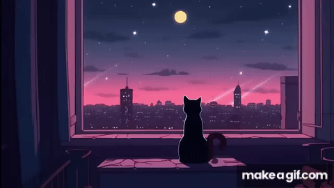

<!-- CABEÇALHO -->

  

<!-- APRESENTAÇÃO ANIMADA -->

  

 

<!-- SOBRE MIM -->

<!-- PRINCIPAIS PROJETOS -->
<h2 align="left">Principais projetos</h2>

### 🔹 FarolFlow
Plataforma de gerenciamento de eventos e tarefas, com organização de equipes, acompanhamento de atividades e visualização do progresso dos projetos.

 

### 🔹 RobóticaIFC
Plataforma educacional voltada ao ensino de robótica, com tutoriais, atividades interativas e acompanhamento do desempenho dos estudantes.

 

### 🔹 Cinemap
Aplicação voltada ao universo cinematográfico, com foco na exploração e organização de informações sobre filmes.

 

<!-- ESTATÍSTICAS -->

  <h2>Estatísticas do GitHub</h2>

  

  

 

<!-- SEQUÊNCIA DE CONTRIBUIÇÕES -->

  

 

<!-- TECNOLOGIAS -->
<h2 align="left">Tecnologias e ferramentas</h2>

  
  

  
  

  
  

  
  

  
  

  

 
 

<!-- REDES SOCIAIS -->
<h2 align="left">Entre em contato</h2>

  

  

  

 

<!-- ANIMAÇÃO DE CONTRIBUIÇÕES -->

  

 

<!-- RODAPÉ -->

  

